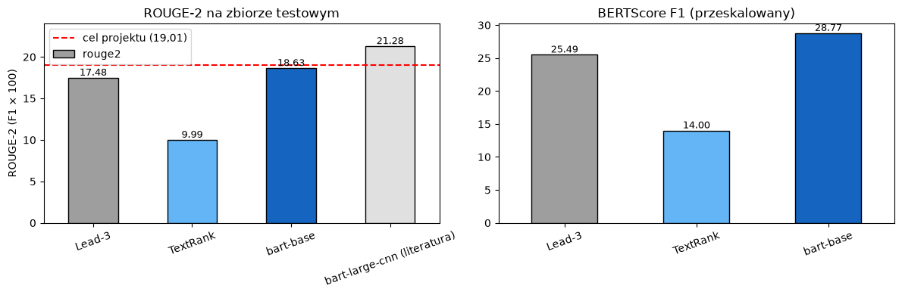
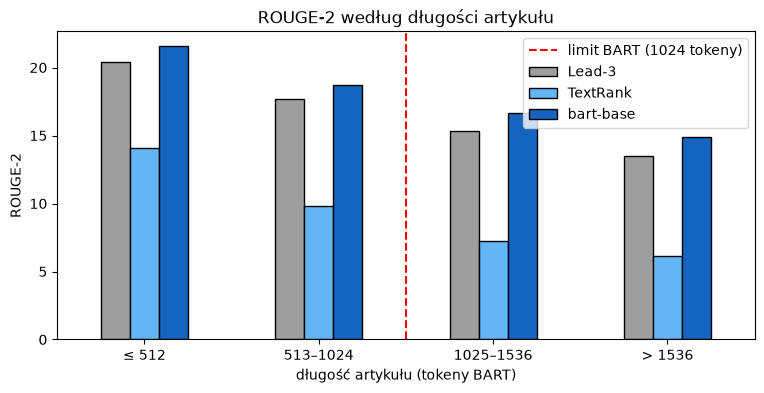
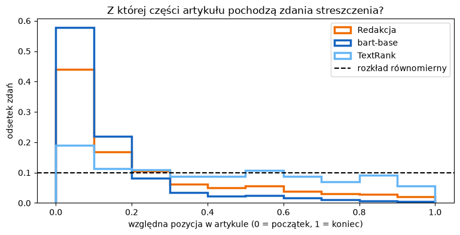

# Automatyczne streszczanie artykułów

**Zbiór danych** [CNN/DailyMail 3.0.0](https://huggingface.co/datasets/abisee/cnn_dailymail) (Hugging Face) 

Projekt dotyczy automatycznego streszczania anglojęzycznych artykułów prasowych. Porównam proste metody ekstrakcyjne z modelem Transformer fine-tunowanym przy ograniczonych zasobach obliczeniowych. Najlepszy model udostępnie jako API.

## Definicja problemu

### Typ zadania

Streszczanie tekstu to zadanie **generowania** w **uczeniu nadzorowanym**: wejściem jest artykuł (`article`), a etykietą streszczenie napisane przez redakcję (`highlights`). Pasuje do niego architektura **Seq2Seq z mechanizmem Attention**, w tym projekcie Transformer encoder-decoder (BART). Streszczenia w CNN/DailyMail są abstrakcyjne, czyli napisane przez ludzi, ale opierają się głównie na początku artykułu: 31% punktów streszczeń pochodzi z pierwszych 10% tekstu (EDA, lead bias).

Nie da się tu użyć accuracy, bo ten sam artykuł można dobrze streścić na wiele sposobów, a model prawie nigdy nie napisze streszczenia identycznego ze streszczeniem redakcji. Dlatego jakość mierzy **ROUGE**, które liczy, ile słów i fraz (n-gramów) pokrywa się ze streszczeniem referencyjnym.

### Pytanie badawcze

> Czy model `facebook/bart-base`, fine-tunowany na podzbiorze CNN/DailyMail na laptopie (MacBook M2 Pro), osiągnie wyższy ROUGE-2 niż baseline Lead-3 i jak daleko będzie od modelu `bart-large-cnn`?

**Pytania pomocnicze:**
1. Czy model gorzej streszcza długie artykuły (powyżej 1024 tokenów), które są obcinane, niż krótkie?
2. Czy model streszcza cały artykuł, czy głównie jego początek?
3. Jak często model podaje fakty, liczby lub nazwiska, których nie ma w artykule?

### Metryka sukcesu

**Metryka główna: ROUGE-2 (F1)** na pełnym zbiorze testowym (11 490 artykułów). Liczy pokrycie par słów, więc lepiej niż ROUGE-1 sprawdza, czy model tworzy sensowne frazy.

| Próg | ROUGE-2 | Znaczenie |
|---|---|---|
| Minimum | > 17,49 | Model pobija baseline Lead-3 (wynik zmierzony) |
| Cel | ≥ 19,01 | Model odrabia 40% różnicy między Lead-3 a `bart-large-cnn` |
| Sufit | ≈ 21,28 | `bart-large-cnn`, punkt odniesienia, a nie wynik projektu |

**Metryki dodatkowe:**

| Metryka | Odpowiada na |
|---|---|
| ROUGE-2 osobno dla krótkich (≤ 1024 tokenów) i długich (> 1024 tokenów) artykułów | Pytanie pomocnicze 1: czy obcinanie szkodzi |
| Z której części artykułu pochodzą słowa streszczenia | Pytanie pomocnicze 2: lead bias |
| % streszczeń z halucynacjami w ręcznej ocenie 30–50 przykładów | Pytanie pomocnicze 3 |
| BERTScore | Podobieństwo znaczeniowe, a nie tylko wspólne słowa |

### Baseline Lead-3

Lead-3 jako streszczenie bierze 3 pierwsze zdania artykułu. Wynik na zbiorze testowym (F1 × 100):

| Model | ROUGE-1 | ROUGE-2 | ROUGE-Lsum |
|---|---|---|---|
| **Lead-3 (zmierzony)** | **40,05** | **17,49** | **36,38** |
| Lead-3 (literatura, See et al. 2017) | 40,34 | 17,70 | 36,57 |
| `bart-large-cnn` (literatura, Lewis et al. 2020) | 44,16 | 21,28 | 40,90 |

Zmierzony wynik różni się od literatury o 0,21 punktu ROUGE-2, więc pipeline ewaluacji działa poprawnie.

### Ograniczenia

| Obszar | Ograniczenie | Konsekwencja |
|---|---|---|
| Sprzęt | MacBook Pro M2 Pro: 16-rdzeniowe GPU (PyTorch MPS), 16 GB pamięci wspólnej, brak CUDA. Próbny trening: ok. 9 s na krok (batch 4), czyli ~18 h na epokę przy 30 tys. przykładów | Tryb hybrydowy: kod rozwijany i testowany na Macu na małych próbkach, właściwy trening w Google Colab (GPU) |
| Długość wejścia | BART czyta maksymalnie 1024 tokeny | 29% artykułów testowych zostanie obciętych |
| Dane | Tylko angielski, tylko newsy, ~91% artykułów z Daily Mail | Model nie przeniesie się wprost na teksty polskie ani naukowe |
| Lead bias | 31% punktów streszczeń pochodzi z pierwszych 10% artykułu, a 64% z pierwszych 30% | Lead-3 jest bardzo mocnym baseline'em; obcinanie końcówki artykułu kosztuje niewiele |
| Distribution shift | Artykuły Daily Mail w train mają podpis autora i daty (34%), których nie ma w validation i test | Czyszczenie train jest konieczne, żeby model uczył się na danych podobnych do testowych |
| Metryka | ROUGE liczy wspólne słowa, nie sens ani poprawność faktów | Dodatkowo BERTScore i ręczna ocena halucynacji |
| Kontaminacja | `t5-small` i `distilbart-cnn-*` widziały CNN/DM wcześniej | Model główny tylko z czystego checkpointu |
| Czas | 6 tygodni na cały projekt | Bez trenowania od zera i bez dużych modeli |
| Green IT | Trening Transformerów zużywa dużo energii | Budowa pipeline'u na 10–20% danych, eksperymenty logowane w MLflow |

Szczegóły i kod: [notebooks/01_definicja_problemu.ipynb](notebooks/01_definicja_problemu.ipynb).

## Dane

- Około 287 tys. przykładów treningowych, 13,4 tys. walidacyjnych i 11,5 tys. testowych.
- Każdy przykład to artykuł (mediana ok. 630 słów, czyli ok. 790 tokenów BART) i streszczenie złożone z punktów *highlights* (mediana ok. 50 słów, zwykle 4 punkty).
- Wczytanie danych: `load_dataset("abisee/cnn_dailymail", "3.0.0")`.

### Analiza eksploracyjna (EDA)

Szczegóły, wykresy i kod: [notebooks/02_eda.ipynb](notebooks/02_eda.ipynb).

| Obszar | Wynik |
|---|---|
| Rozkłady długości | Prawoskośne: większość artykułów ma 500–800 tokenów, ogon sięga ~2500. Train i test mają podobne długości (średnio 692 vs 684 słowa). Jedno słowo to ok. 1,26 tokenu |
| Obcinanie | Ok. 30% artykułów w train przekracza limit BART (1024 tokeny). 95% streszczeń ma ≤ ~114 tokenów |
| Kompresja | Mediana 0,078: streszczenie ma ok. 1/13 długości artykułu. Długość streszczenia słabo zależy od długości artykułu (korelacja 0,29) |
| Lead bias | 31% punktów streszczeń pochodzi z pierwszych 10% artykułu (3 razy więcej niż przy rozkładzie równomiernym), 64% z pierwszych 30% |
| Szum w danych | Podpis autora i daty (`By .`, `PUBLISHED: .`, `UPDATED: .`) w 20–34% artykułów **tylko w train**, a w validation i test 0% (distribution shift: zbiór podzielono według daty publikacji). „Scroll down for video” we wszystkich podziałach (16–26%) |
| Duplikaty | 3098 powtórzonych par w train. Ok. 1800 różnych artykułów ma to samo streszczenie |
| Zepsute przykłady | 29 „artykułów” poniżej 50 słów (podpisy zdjęć, listy nazwisk) i 26 par ze streszczeniem dłuższym niż artykuł |
| Przeciek danych | train ∩ test = 0, train ∩ validation = 1, validation ∩ test = 0 |

### Preprocessing

Kod: [src/preprocessing.py](src/preprocessing.py) (te same funkcje używane w treningu, ewaluacji i API), notatnik: [notebooks/03_preprocessing.ipynb](notebooks/03_preprocessing.ipynb). Po czyszczeniu i filtrowaniu train ma 283 939 przykładów (usunięto 1,11%). Lead-3 na oczyszczonych artykułach testowych się nie zmienia (40,06 / 17,48 / 36,37), więc wyniki pozostają porównywalne z literaturą.

Decyzje wynikające z EDA:

| Decyzja | Wartość |
|---|---|
| `max_input_length` | 1024 tokeny (maksimum BART; obcinana jest końcówka, z której rzadko pochodzą streszczenia) |
| `max_target_length` | 128 tokenów (mieści ok. 97% streszczeń) |
| Czyszczenie artykułów | Usunięcie podpisu autora i daty z początku artykułu oraz „Scroll down for video” |
| Czyszczenie streszczeń (train) | Spacja przed kropką (` .` → `.`), dopiski `WARNING: ...` |
| Filtrowanie train | Usunięcie powtórzonych par, artykułów < 50 słów, par ze streszczeniem dłuższym niż artykuł i 1 artykułu wspólnego z validation (łącznie ok. 1,1% przykładów) |
| Zbiór testowy | Bez zmian w streszczeniach i liczbie przykładów; artykuły czyszczone tą samą funkcją co w train i w API |
| Podzbiór treningowy | 20–50 tys. przykładów; ostateczna wartość po pomiarze czasu kroku na GPU w Colabie |
| Miejsce treningu | Google Colab (GPU T4): 0,074 s na przykład, czyli ok. 30 razy szybciej niż na Macu |
| Tokenizacja | Tokenizer `facebook/bart-base`, dynamiczny padding przez `DataCollatorForSeq2Seq` |

## Modele

| Rola | Model | Opis |
|---|---|---|
| Baseline 1 | **Lead-3** | Pierwsze 3 zdania artykułu |
| Baseline 2 | **TextRank** | Streszczenie ekstrakcyjne (biblioteka `sumy`) |
| Model główny | **`facebook/bart-base`** | Fine-tuning na CNN/DM przez `Seq2SeqTrainer` |
| Punkt odniesienia | `facebook/bart-large-cnn` | Gotowy model wytrenowany na CNN/DM, traktowany jako „sufit” |
| Opcjonalnie | LLM zero-shot | Porównanie jakości streszczeń z wartością ROUGE |

Jako model główny wybrano `bart-base`, bo:
- **nie był wcześniej trenowany na CNN/DailyMail**, w przeciwieństwie do oryginalnego `t5-small` (widział ten zbiór podczas pretreningu) i `distilbart-cnn-*` (jest już na nim fine-tunowany);
- czyta do 1024 tokenów, a modele T5 zwykle 512, co obcięłoby 82% artykułów zamiast 29%;
- mieści się w pamięci laptopa (~140M parametrów);
- jest mniejszą wersją modelu-sufitu, więc porównanie jest uczciwe.

### Trening

Notatnik: [notebooks/04_trening_colab.ipynb](notebooks/04_trening_colab.ipynb) (Google Colab, GPU Tesla T4).

| Parametr | Wartość |
|---|---|
| Dane treningowe | 50 000 oczyszczonych przykładów (losowa próbka, `seed=42`) |
| Epoki | 1 (3125 kroków) |
| Batch | 4 × akumulacja gradientu 4 = 16 |
| Learning rate | 5e-5, rozgrzewka 5% kroków, weight decay 0,01 |
| Precyzja | fp16 |
| Czas treningu | 43 min (0,074 s na przykład; na Macu ok. 2,2 s) |
| Wybór checkpointu | najniższa strata walidacyjna (500 artykułów), krok 3000 |

Strata walidacyjna spadła z 2,25 do ~2,16, a odstęp od straty treningowej (~0,2) nie rósł, więc model się nie przeuczał. Eksperymenty są logowane w **MLflow**.

**Strojenie parametrów generowania** (na 500 artykułach walidacyjnych, bez ponownego treningu):

| `num_beams` | `length_penalty` | ROUGE-2 | Średnia długość (słowa) |
|---|---|---|---|
| **4** | **1,0** | **19,60** | 58,6 |
| 4 | 2,0 | 19,55 | 62,8 |
| 2 | 1,0 | 19,51 | 58,3 |
| 6 | 2,0 | 19,22 | 63,0 |

Różnice są małe (0,38 punktu), więc model jest mało wrażliwy na parametry generowania. Wybrane: `num_beams=4`, `length_penalty=1.0`, `no_repeat_ngram_size=3`, `min_length=30`, `max_new_tokens=128`.

## Analiza wyników

Notatnik: [notebooks/05_analiza_wynikow.ipynb](notebooks/05_analiza_wynikow.ipynb). Pełny zbiór testowy (11 490 artykułów).

### Wyniki

| Model | ROUGE-1 | ROUGE-2 | ROUGE-Lsum | BERTScore F1* | Średnia długość (słowa) |
|---|---|---|---|---|---|
| Lead-3 | 40,06 | 17,48 | 36,37 | 25,49 | 76,4 |
| TextRank | 29,71 | 9,99 | 26,46 | 14,00 | 106,0 |
| **`bart-base`, fine-tuning (mój model)** | **41,06** | **18,63** | **37,98** | **28,77** | 57,7 |
| `bart-large-cnn` (literatura) | 44,16 | 21,28 | 40,90 | – | – |
| *Streszczenia redakcji* | | | | | *55,0* |

\* BERTScore z modelem `roberta-large`, przeskalowany względem poziomu losowego (`rescale_with_baseline=True`).



**Odpowiedź na pytanie badawcze:**
- **Minimum osiągnięte:** model pobija Lead-3 we wszystkich metrykach. Przewaga jest istotna statystycznie (bootstrap, 1000 prób): ROUGE-2 +1,15 (95% CI [0,97; 1,34]), BERTScore +3,28 (95% CI [3,07; 3,48]).
-  **Cel nieosiągnięty:** ROUGE-2 = 18,63 wobec celu 19,01 (brakuje 0,38 punktu). Model odrobił 30% różnicy między Lead-3 a `bart-large-cnn` (cel: 40%).
- Model wygrywa z Lead-3 w 53,7% artykułów: średnia przewaga jest pewna, ale dla prawie połowy artykułów Lead-3 jest równie dobry.

### Pytania pomocnicze

**1. Czy obcinanie do 1024 tokenów szkodzi?** Nie zauważalnie. Wszystkie systemy, także nieobcinany Lead-3, mają niższy ROUGE-2 dla dłuższych artykułów, więc długie artykuły są po prostu trudniejsze. Przewaga modelu nad Lead-3 nie maleje dla obciętych artykułów (+1,01 dla 513–1024 tokenów, +1,41 dla > 1536).



**2. Cały artykuł czy początek?** Głównie początek, i to jeszcze bardziej niż redakcja: 57,7% zdań streszczeń modelu pochodzi z pierwszych 10% artykułu (redakcja: 43,9%), a z drugiej połowy tylko 6,6% (redakcja: 17,5%). Model głównie kopiuje: 6,1% nowych bigramów wobec 51,2% u redakcji. Działa jak „inteligentny Lead-3”: wybiera, skraca i łączy zdania z początku.



**3. Halucynacje:** automatyczna ocena spójności faktów modelem NLI (`cross-encoder/nli-deberta-v3-base`, metoda w stylu SummaC) na 500 losowych artykułach. Zdanie jest niepoparte, jeśli nie wynika (entailment < 0,5) z żadnego fragmentu artykułu.

| | % zdań niepopartych | % streszczeń z ≥ 1 niepopartym zdaniem |
|---|---|---|
| Lead-3 (tylko kopiuje, czyli poziom błędu metody) | 11,3 | 33,6 |
| **`bart-base`** | **8,2** | **21,0** |
| Redakcja (parafrazy) | 32,8 | 72,0 |

Model ma mniej oznaczonych zdań niż Lead-3, którego zdania są z definicji poparte, więc nie widać śladów częstych halucynacji. Weryfikacja oznaczonych przykładów na pełnym tekście artykułów pokazała, że większość to fałszywe alarmy metody: NLI wybiera zły fragment albo nie łączy informacji z odległych miejsc artykułu. Potwierdzony błąd to **zamiana ról osób** (artykuł: Bachmann powiedziała Obamie „bomb Iran”; model: Obama powiedział jej „bomb Iran”). Halucynacje są więc rzadkie, ale występują, głównie jako odwrócenie relacji między faktami. NLI daje tylko górne oszacowanie; dokładną liczbę dałaby ręczna ocena większej próbki (dalszy krok).

### Wnioski z przykładów

- **Słabość wynikająca z lead bias:** 2,3% streszczeń ma ROUGE-2 = 0. Typowo artykuł zaczyna się od historii jednej osoby, a główny temat pojawia się dalej, a model (tak jak Lead-3) streszcza wstęp.
- **Ograniczenia ROUGE:** w przykładzie z największą przewagą Lead-3 streszczenie modelu jest sensowne, ale skupia się na innych szczegółach niż redakcja. ROUGE karze za inny wybór treści, dlatego warto uzupełniać go BERTScore i oceną ręczną.

## API

Kod: [api/main.py](api/main.py), testy: [tests/test_api.py](tests/test_api.py).

| Endpoint | Opis |
|---|---|
| `GET /health` | Czy API działa i model jest załadowany |
| `POST /summarize` | Streszczenie artykułu: `{"text": "...", "max_length": 128}` |
| `GET /docs` | Interaktywna dokumentacja (Swagger UI): można tu wkleić artykuł i wygenerować streszczenie w przeglądarce |

- Model ładuje się raz, przy starcie aplikacji (`lifespan`).
- Tekst wejściowy jest czyszczony **tą samą funkcją** co dane treningowe (`src/preprocessing.py`), np. usuwany jest nagłówek Daily Mail.
- Walidacja: tekst musi mieć co najmniej 50 słów (krótsze usuwano z treningu) i najwyżej 30 000 znaków; `max_length` od 30 do 256 tokenów. Błędne zapytania dostają odpowiedź `422`.
- Generowanie używa najlepszych parametrów ze strojenia (`num_beams=4`, `length_penalty=1.0`).
- Odpowiedź zawiera streszczenie, liczbę słów po oczyszczeniu, informację, czy artykuł obcięto do 1024 tokenów, i czas generowania (~3 s na MacBooku M2 Pro).

Przykład:

```bash
curl -X POST http://localhost:8000/summarize \
  -H "Content-Type: application/json" \
  -d '{"text": "Scientists have used cosmic rays from the distant universe to study lightning ..."}'
```

```json
{
  "summary": "Scientists in the Netherlands were using the Lofar radio telescope.\nThey found it could measure changes in lightning caused by cosmic rays.\nA storm can have hundreds of millions of volts over multiple kilometres.",
  "input_words": 103,
  "truncated": false,
  "seconds": 2.95
}
```

**Wdrożenie:** API działa lokalnie. Na czas prezentacji można je udostępnić w internecie przez tymczasowy tunel Cloudflare (bez zakładania konta, link działa, dopóki tunel jest uruchomiony). Stały hosting (np. Hugging Face Spaces albo Google Cloud Run) to możliwy dalszy krok. Darmowe hostingi z ~512 MB RAM nie wystarczą, bo sam model ma 560 MB.

## Uruchomienie

```bash
pip install -r requirements.txt
```

Plik `requirements.txt` zawiera biblioteki użyte w projekcie, w wersjach z MacBooka. Trening uruchamiano w Google Colab, gdzie notatnik `04_trening_colab.ipynb` sam instaluje potrzebne pakiety (w tym `mlflow`).

**Kolejność notatników:** `01_definicja_problemu` → `02_eda` → `03_preprocessing` (zapisuje `data/processed/`) → `04_trening_colab` (Colab, GPU) → `05_analiza_wynikow`.

**Model:** wytrenowany model (560 MB) nie jest w repozytorium. Po treningu w Colabie trzeba skopiować folder `models/bart-base_lr5e-05_ep1_najlepszy` z Dysku Google do `models/bart-base_najlepszy/`.

**API lokalnie:**

```bash
python3 -m uvicorn api.main:app --port 8000
# dokumentacja: http://localhost:8000/docs
python3 -m pytest tests/ -v      # testy (6)
```

**Tymczasowy publiczny link** (w drugim oknie terminala, gdy API działa; wymaga `brew install cloudflared`):

```bash
cloudflared tunnel --url http://localhost:8000
# w wyniku pojawi się adres https://....trycloudflare.com, a dokumentacja jest pod /docs
```

### Sprawdzenie pipeline'u ewaluacji (Lead-3)

```python
from datasets import load_dataset
import evaluate, nltk

nltk.download("punkt_tab")
ds = load_dataset("abisee/cnn_dailymail", "3.0.0", split="test")
rouge = evaluate.load("rouge")

lead3 = ["\n".join(nltk.sent_tokenize(a)[:3]) for a in ds["article"]]
refs = ["\n".join(nltk.sent_tokenize(h)) for h in ds["highlights"]]
print(rouge.compute(predictions=lead3, references=refs, use_stemmer=True))
```

Zdania są rozdzielane znakiem nowej linii celowo, bo bez tego `rougeLsum` (wersja ROUGE-L raportowana w publikacjach) liczy się błędnie. Wynik około 40 / 17,5 / 36 dla ROUGE-1 / 2 / Lsum oznacza, że ewaluacja działa poprawnie.

## Licencja danych

Zbiór CNN/DailyMail jest udostępniany do celów badawczych. Prawa autorskie do artykułów należą do wydawców CNN i Daily Mail.
